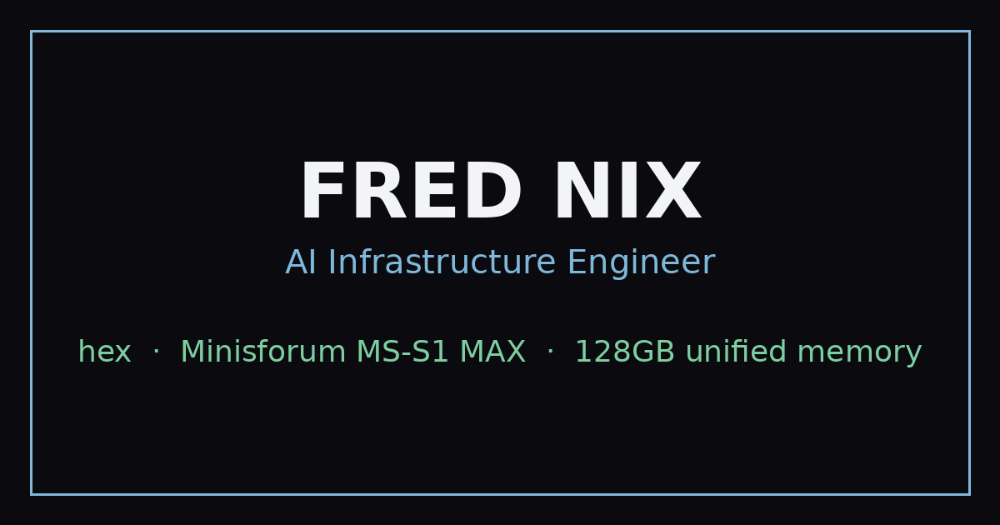
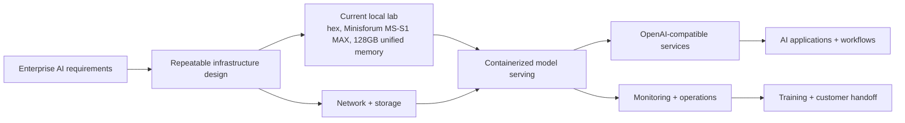
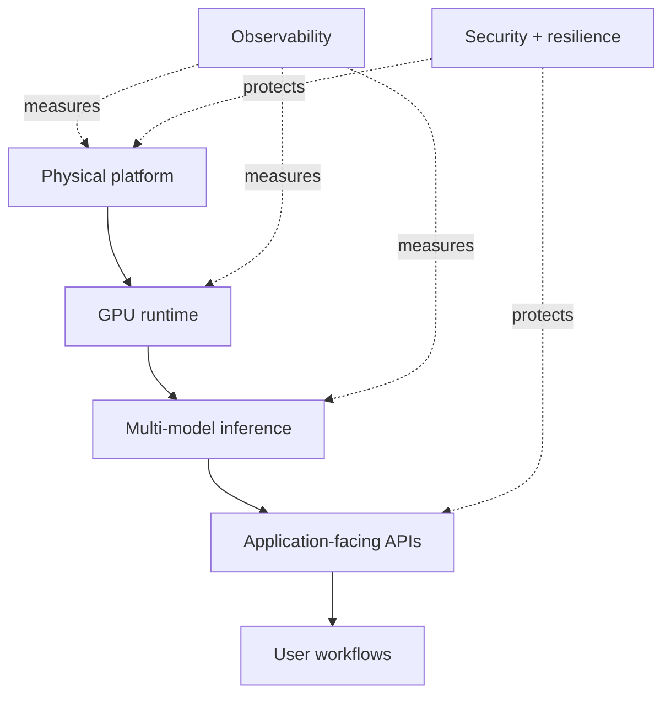
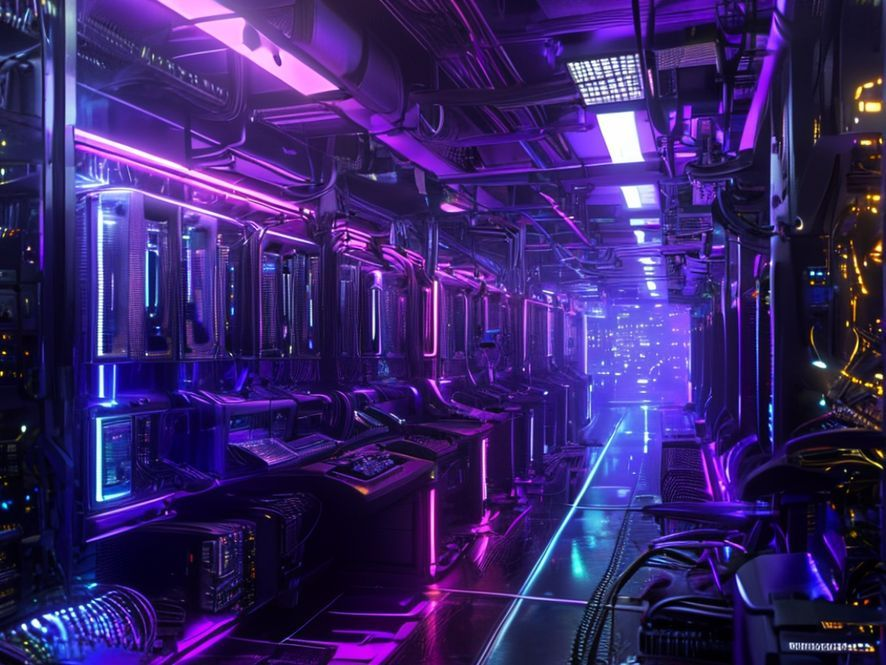
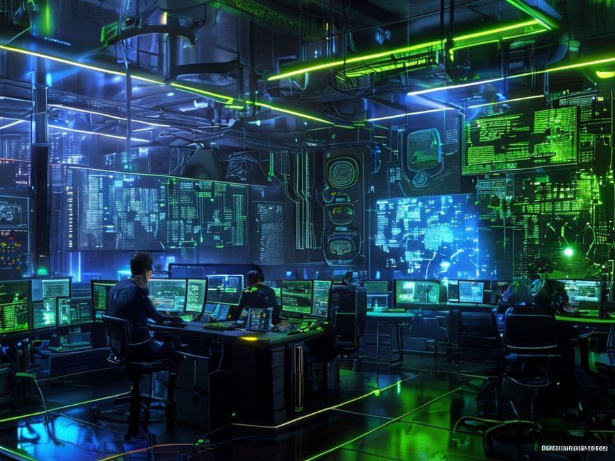
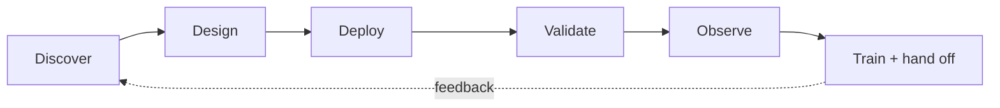
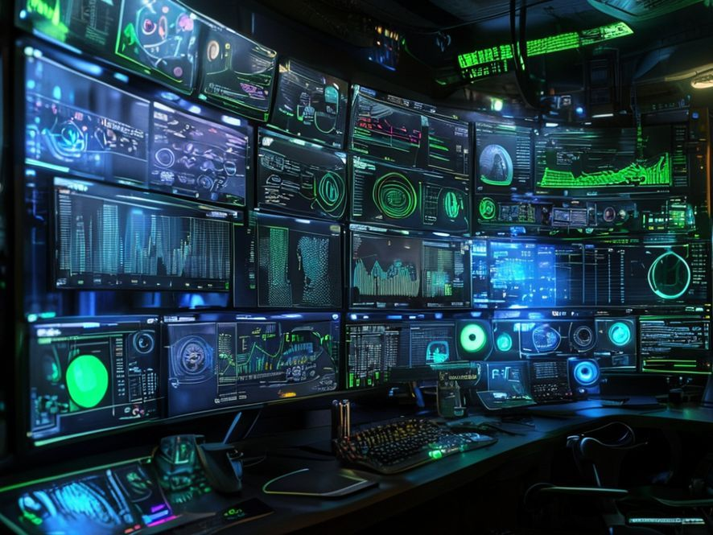
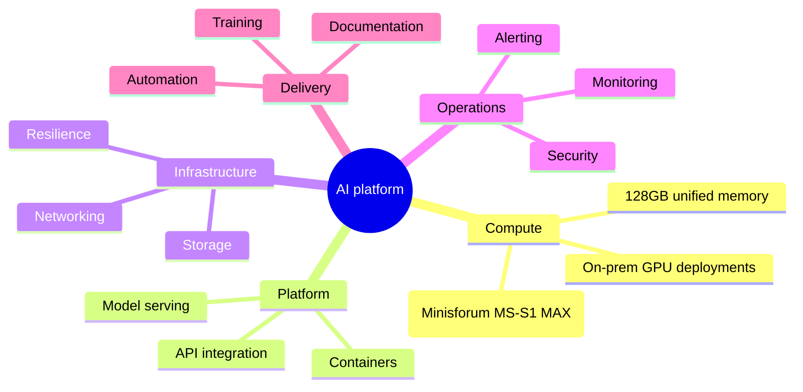
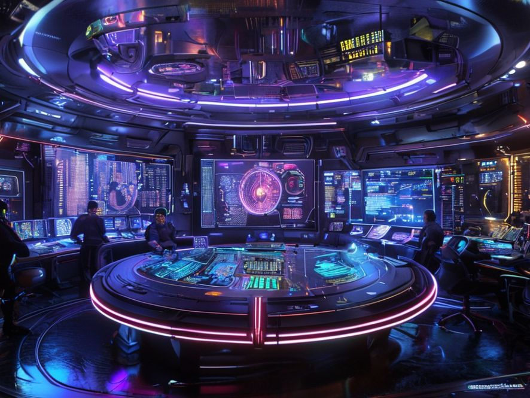

<p align="center">
  <a href="https://nixfred.com/ai/">
    
  </a>
</p>

<h1 align="center">AI Infrastructure Portfolio</h1>

<p align="center">
  A visual case study of the systems, delivery practices, and field experience behind the BTA AI POD.
</p>

<p align="center">
  <a href="https://nixfred.com/ai/"><strong>Explore the case study</strong></a>
  ·
  <a href="https://nixfred.com/ai/resumerge/">View the résumé portfolio</a>
</p>

## What this repository is

This repository powers two complementary, static portfolio experiences:

| Experience | Purpose |
| --- | --- |
| [`/ai/`](https://nixfred.com/ai/) | A narrative case study covering the problem, architecture, deployment model, operational capabilities, and lessons behind an enterprise AI platform. |
| [`/ai/resumerge/`](https://nixfred.com/ai/resumerge/) | A résumé-oriented view connecting that platform work to roles, skills, outcomes, and career history. |

The current local AI lab is **hex**, a Minisforum MS-S1 MAX with 128GB of unified memory. A prior headline implementation, the **BTA AI POD**, was an enterprise AI environment with four NVIDIA L40S GPUs, 184 GB of aggregate VRAM, nine hot-swappable models, and more than 100,000 AI sessions.



## From hardware to usable AI

The story is intentionally broader than a GPU specification sheet. It shows how compute, networking, storage, containers, model serving, observability, resilience, security, documentation, and enablement fit together as one delivery system.



<p align="center">
  
  
</p>

<p align="center"><sub>Illustrative portfolio artwork representing the GPU and operations layers—not documentary photography of a specific deployment.</sub></p>

## Delivery model

The portfolio emphasizes a practical path from discovery to an environment that another team can operate. Infrastructure is only complete when it is observable, documented, repeatable, and handed over with confidence.



<p align="center">
  
  
</p>

<p align="center"><sub>The visual language connects model intelligence with the operational discipline required to run it reliably.</sub></p>

## Capability map



<p align="center">
  
  
</p>

<p align="center"><sub>Supporting artwork represents the infrastructure and command-center themes used throughout both portfolio views.</sub></p>

## Site architecture

There is deliberately no framework, package manager, or build pipeline in this repository. Each experience is a self-contained HTML document with inline CSS and JavaScript, backed by a shared image collection.

```text
.
├── index.html             # Primary AI infrastructure case study
├── resumerge/
│   └── index.html         # Résumé and career narrative
├── images/
│   └── img01.png … img12.png
└── share-image.png        # Social card and README hero
```

The pages include responsive layouts, animated counters and reveals, visual galleries, and lightbox interactions. Google Fonts is the only page-level external resource; the site itself has no runtime API or data-store dependency.

## Run locally

Serve the repository root with any static file server:

```bash
python3 -m http.server 8000
```

Then open:

- `http://localhost:8000/` for the main case study
- `http://localhost:8000/resumerge/` for the résumé portfolio

Opening the files through a local server most closely matches their deployed URL behavior.

## Deployment boundary

This repository contains the deployable static assets, but no hosting workflow or infrastructure configuration. The public experience is intended to live under [`nixfred.com/ai/`](https://nixfred.com/ai/); publishing and host orchestration are managed outside this repository.

---

<p align="center">
  Built to make enterprise AI infrastructure understandable—from silicon to handoff.
</p>
